# Create a new drawing project at the drawing station.

Started 2026-11-07 · finished · 11 drawings

> The initial drawing and its revision are complete

## 1. 2026-11-07

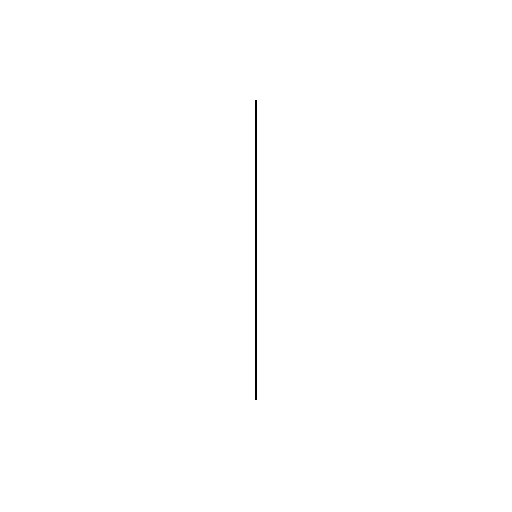

Start a new drawing project by creating an initial sketch at the drawing station.

## 2. 2026-11-07

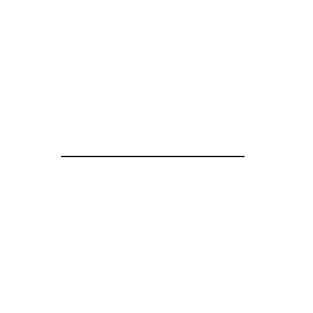

Continue the initial sketch by adding a horizontal line across the canvas.

## 3. 2026-11-07

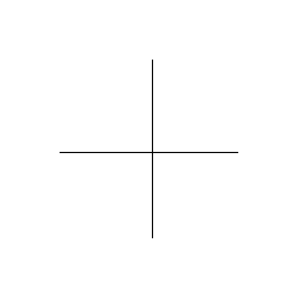

Draw a vertical line to complete the initial sketch.

## 4. 2026-11-07

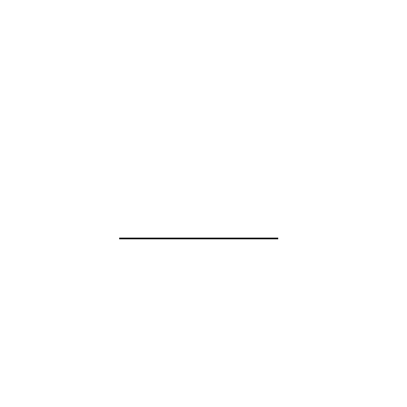

Add a horizontal line to the existing sketch.

## 5. 2026-11-07

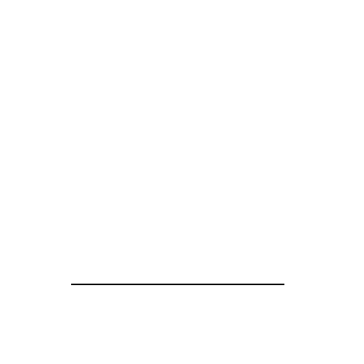

Continuing the existing drawing with a horizontal line at the bottom of the canvas.

## 6. 2026-11-07

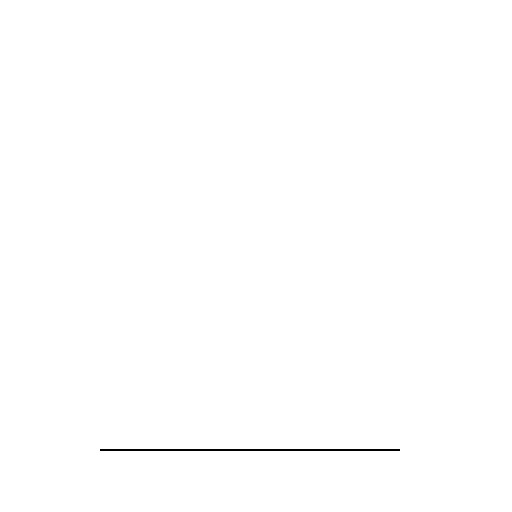

Drawing a horizontal line across the bottom of the canvas to continue the existing project.

## 7. 2026-11-07

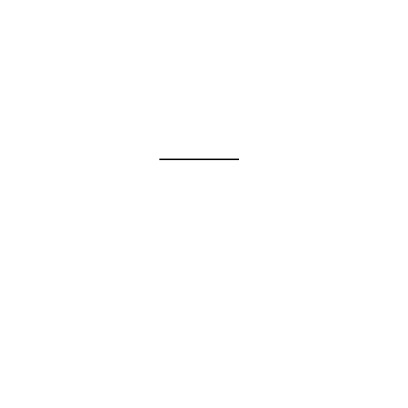

Drawing a line across the canvas to continue the existing project.

## 8. 2026-11-07

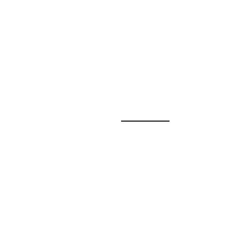

Drawing a line across the canvas to continue the existing project.

## 9. 2026-11-07

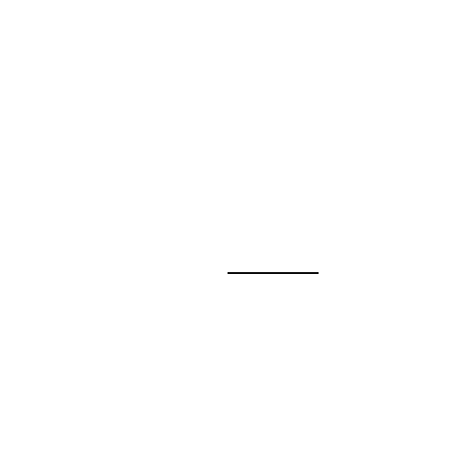

Continue the existing drawing project by adding a line horizontally across the canvas.

## 10. 2026-11-07

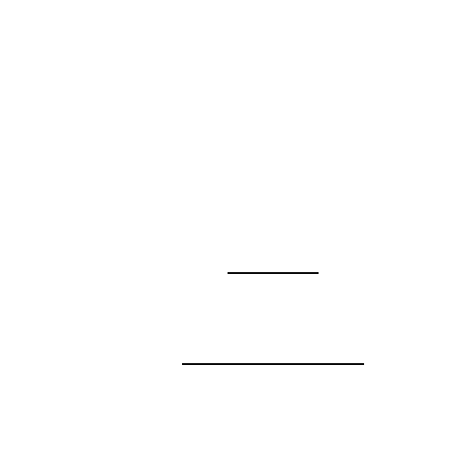

Continue the existing drawing project by adding a line vertically to the canvas.

## 11. 2026-11-07

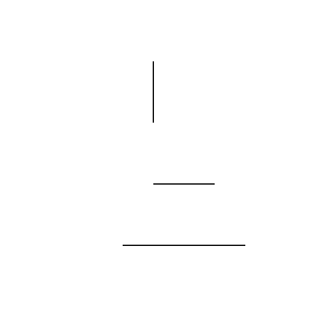

Revise the existing drawing by adding a vertical line to create a more complex sketch.

[Back to the studio](../README.md)
