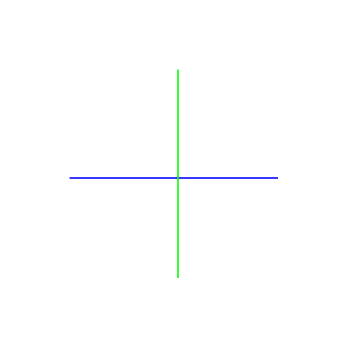

# Create a new drawing project with a simple line at the drawing station.

Started 2026-11-07 · active · 5 drawings

## 1. 2026-11-07

Starting a new drawing project with a simple line at the drawing station.

## 2. 2026-11-07

Drawing a simple line at the drawing station to continue the new project.

## 3. 2026-11-07

Drawing a horizontal line to continue the new project.

## 4. 2026-11-07

Draw a blue line across the canvas to continue the new project.

## 5. 2026-11-07

Drawing a simple green line to add variety to the existing blue line.

[Back to the studio](../README.md)
