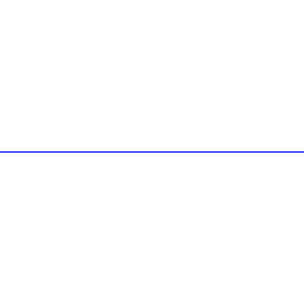
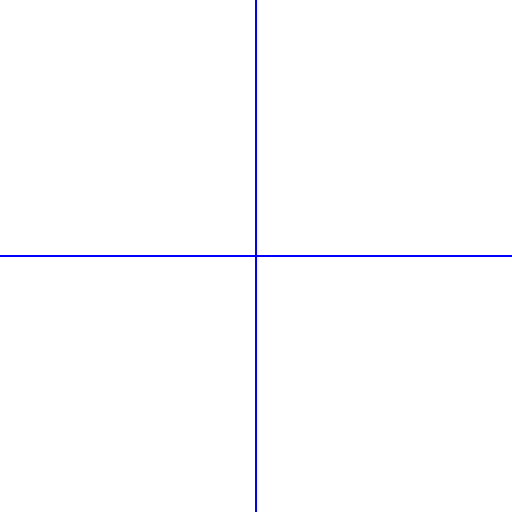
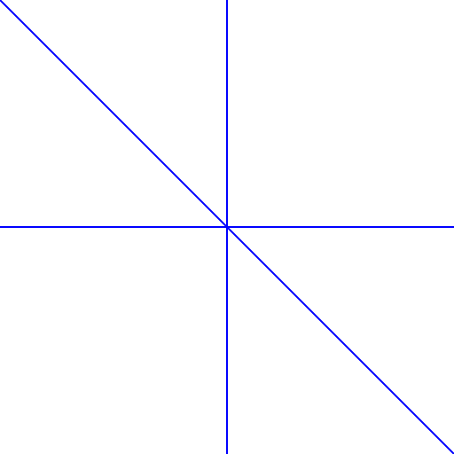
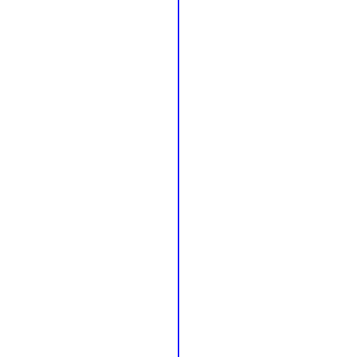
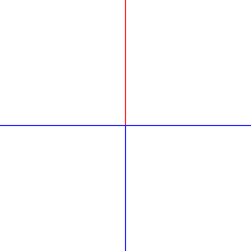
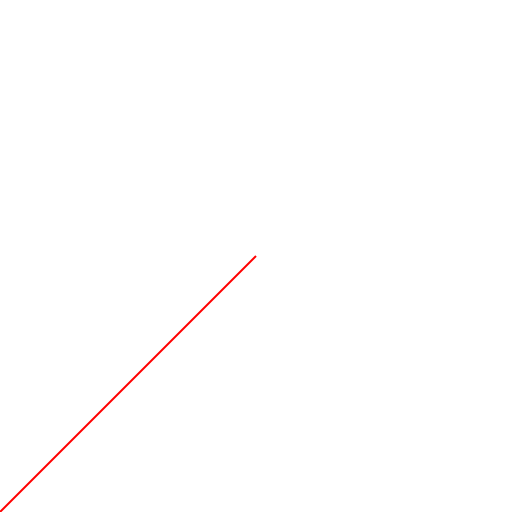
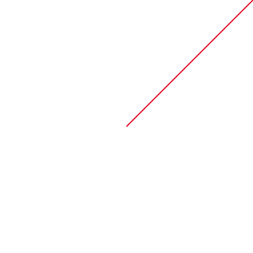
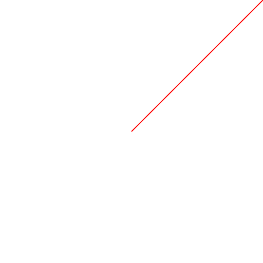

# Create a new drawing project with a diagonal blue line at the drawing station.

Started 2026-11-07 · finished · 12 drawings

> The drawing project with diagonal blue lines is complete.

## 1. 2026-11-07

Starting a new drawing project with a diagonal blue line at the drawing station.

## 2. 2026-11-07

Drawing a vertical blue line to add more complexity to the diagonal blue line project.

## 3. 2026-11-07

Adding a vertical blue line to the existing diagonal blue line project.

## 4. 2026-11-07

Drawing a diagonal and vertical blue line to enhance the existing project.

## 5. 2026-11-07

Adding a vertical blue line to enhance the existing diagonal blue line project.

## 6. 2026-11-07

Drawing a vertical blue line to add more complexity to the existing diagonal blue line project.

## 7. 2026-11-07

Continue working on the diagonal blue line project with a red vertical line.

## 8. 2026-11-07

Add a red vertical line to the existing diagonal blue lines.

## 9. 2026-11-07

Continue drawing a diagonal blue line to enhance the existing project.

## 10. 2026-11-07

Drawing a red vertical line to enhance the existing diagonal blue line project.

## 11. 2026-11-07

Add a red vertical line to enhance the existing diagonal blue lines project.

## 12. 2026-11-07

Add diagonal blue lines to enhance the existing project at the drawing station.

[Back to the studio](../README.md)
