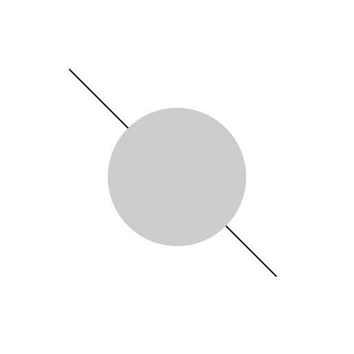
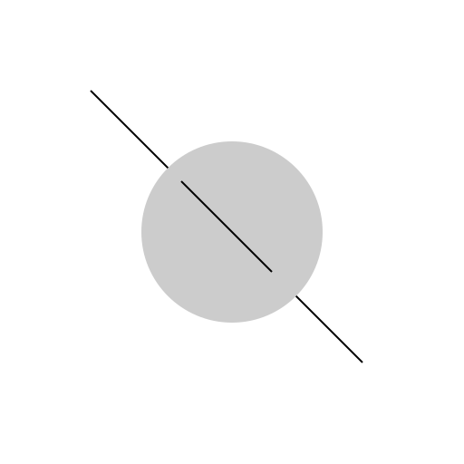
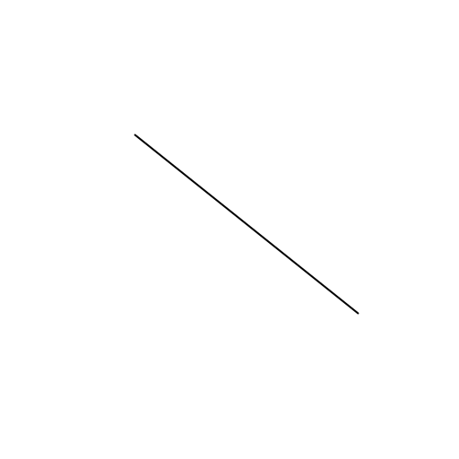
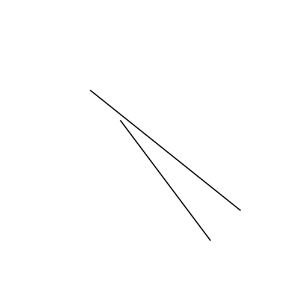
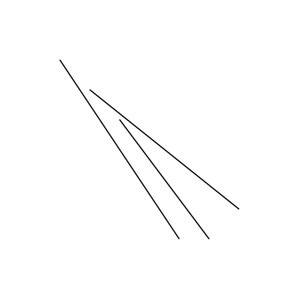
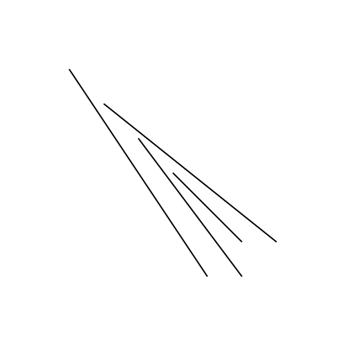
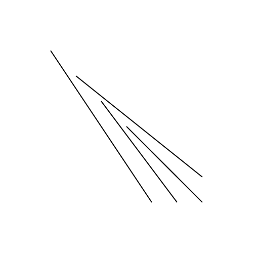
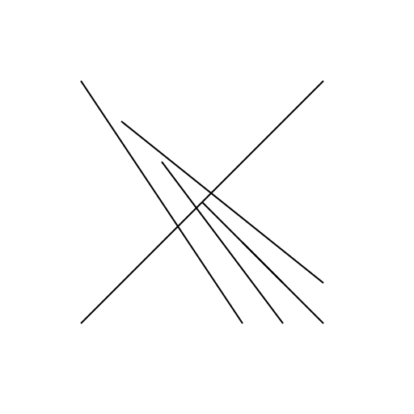

# Create a new project to start drawing.

Started 2026-11-07 · finished · 8 drawings

> Completed initial drawing and revision process

## 1. 2026-11-07

Drawing the initial sketch for the new project.

## 2. 2026-11-07

Revise the initial sketch by adding a new line to make it more complex.

## 3. 2026-11-07

Revise the initial sketch by adding a line to make it more complex.

## 4. 2026-11-07

Add a new line to the existing sketch to make it more complex.

## 5. 2026-11-07

Revise the existing sketch by adding a line to make it more complex.

## 6. 2026-11-07

Drawing a more complex sketch at the drawing station

## 7. 2026-11-07

Drawing a more complex sketch at the drawing station.

## 8. 2026-11-07

Drawing a more complex sketch with a closed shape at the drawing station.

[Back to the studio](../README.md)
