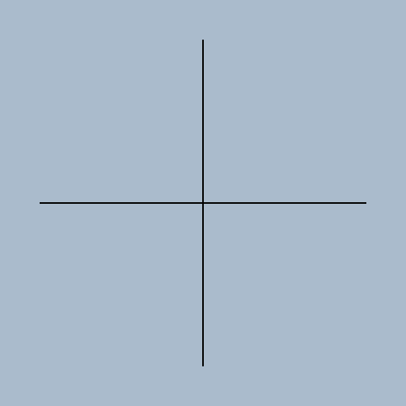
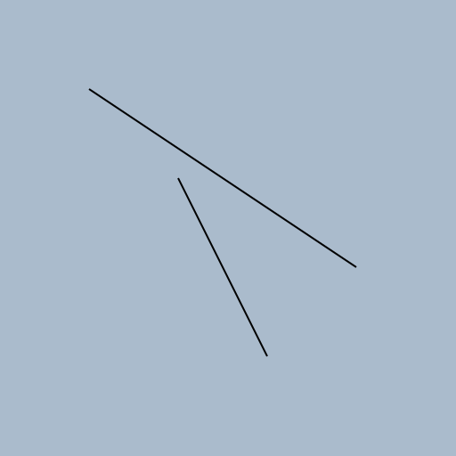
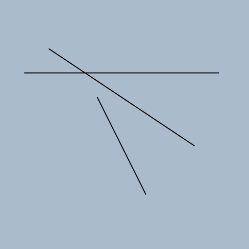
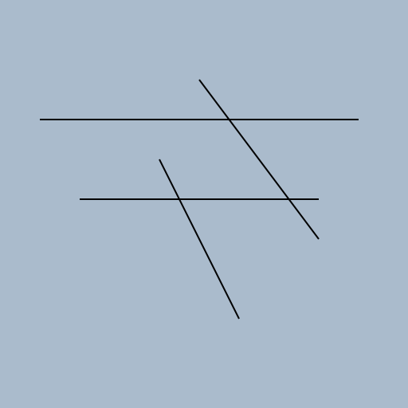

# Start a new drawing project by creating an initial sketch at the drawing station.

Started 2026-11-07 · finished · 4 drawings

> All required drawings are completed

## 1. 2026-11-07

Starting a new drawing project with an initial sketch at the drawing station.

## 2. 2026-11-07

Expanding the initial sketch by adding two lines to create a more complex drawing.

## 3. 2026-11-07

Expanding the initial sketch by adding a third line to create a more complex drawing.

## 4. 2026-11-07

Adding a fourth line to the existing drawing to create a more complex project.

[Back to the studio](../README.md)
