# Start a new drawing project with an initial diagonal line.

Started 2026-11-07 · finished · 12 drawings

> Completed the initial diagonal line drawing project

## 1. 2026-11-07

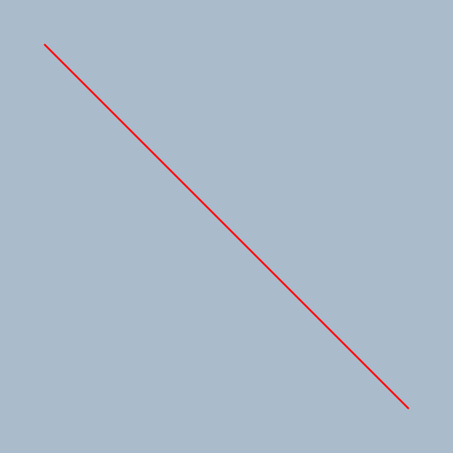

Starting a new drawing project with a diagonal line at the drawing station.

## 2. 2026-11-07

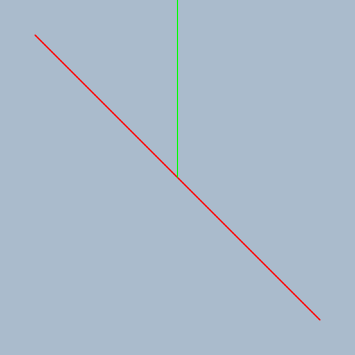

Add a vertical green line to the diagonal red line to create a more complex drawing.

## 3. 2026-11-07

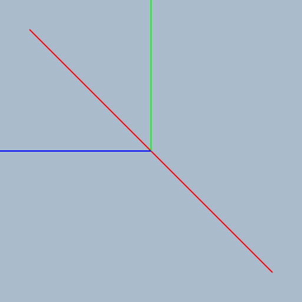

Revise the drawing by adding a blue vertical line to the existing diagonal and green lines.

## 4. 2026-11-07

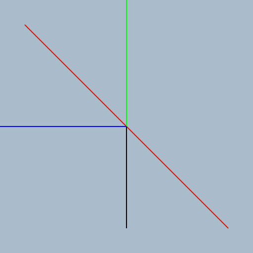

Drawing a blue vertical line to the existing diagonal and green lines.

## 5. 2026-11-07

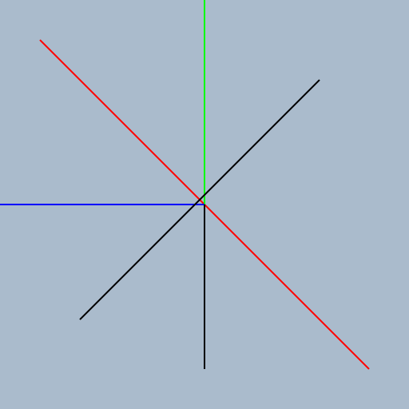

Drawing a blue vertical line to the existing diagonal and green lines.

## 6. 2026-11-07

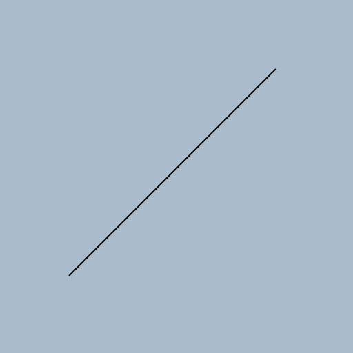

Drawing a black horizontal line across the canvas to add complexity to the existing project.

## 7. 2026-11-07

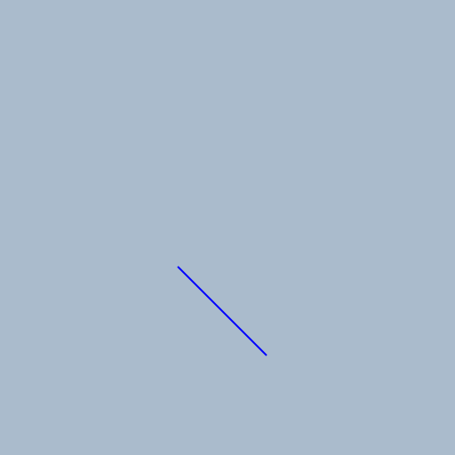

Drawing a blue vertical line to add complexity to the existing project.

## 8. 2026-11-07

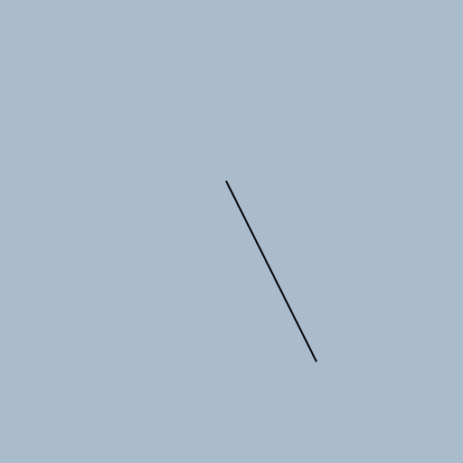

Drawing a black horizontal line to add complexity to the existing project.

## 9. 2026-11-07

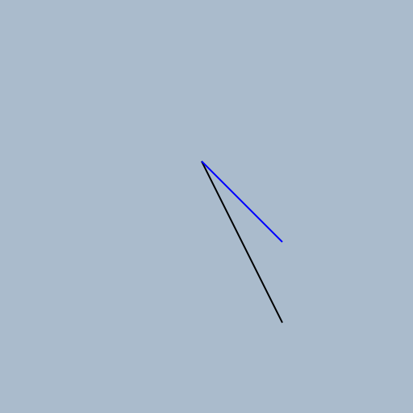

Drawing a black diagonal line and a blue horizontal line to add complexity to the existing project.

## 10. 2026-11-07

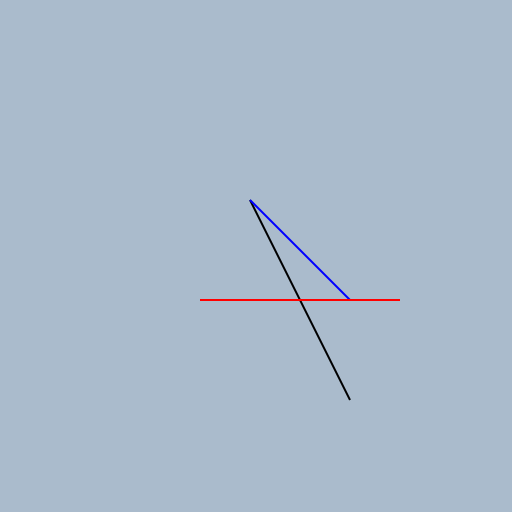

Add a red horizontal line to the existing diagonal and blue lines.

## 11. 2026-11-07

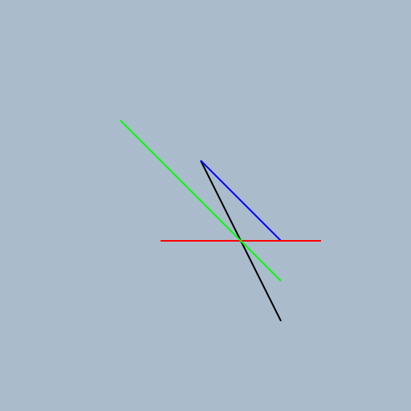

Drawing a green line to add complexity to the existing diagonal and blue lines.

## 12. 2026-11-07

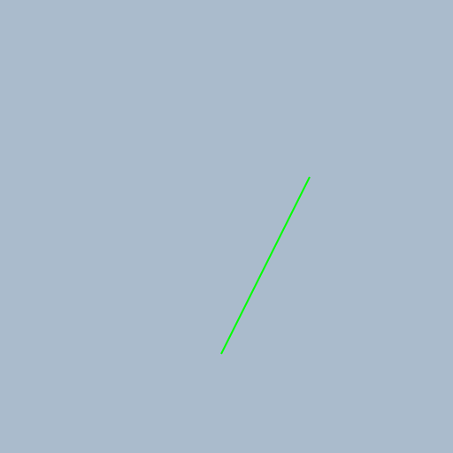

Add a green vertical line to enhance the existing diagonal and blue lines.

[Back to the studio](../README.md)
