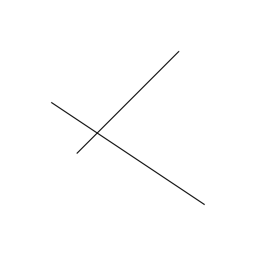
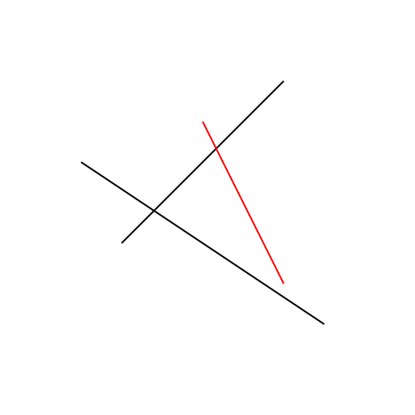
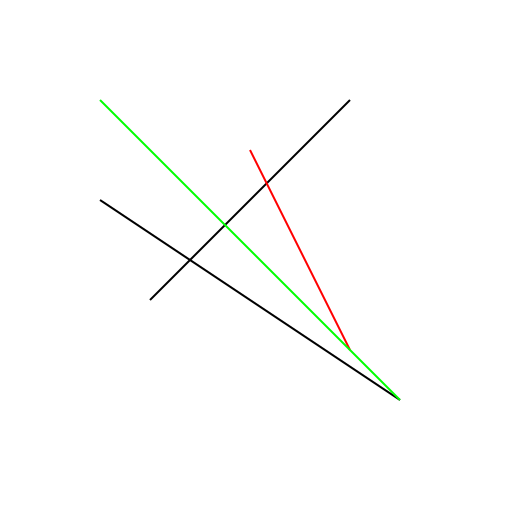
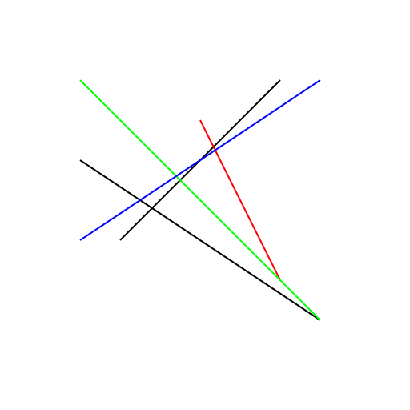
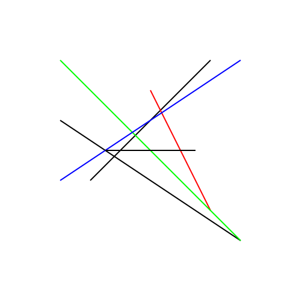
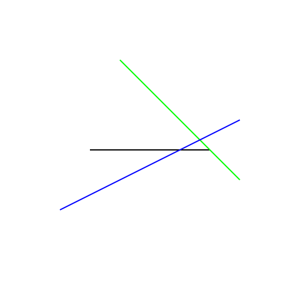
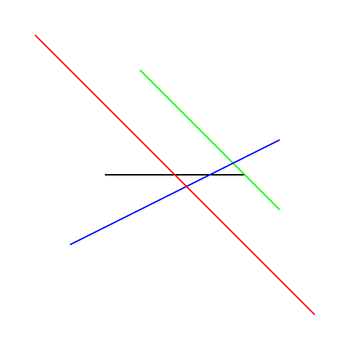

# Start a new drawing project with an initial sketch.

Started 2026-11-07 · finished · 8 drawings

> Completed the initial sketch and its revision

## 1. 2026-11-07

Creating a new drawing project with an initial sketch at the drawing station.

## 2. 2026-11-07

Adding a red line to the initial sketch to create a more complex drawing.

## 3. 2026-11-07

Adding a green line to the initial sketch to create a more complex drawing.

## 4. 2026-11-07

Revise the initial sketch by adding more lines to create a more complex drawing.

## 5. 2026-11-07

Revise the initial sketch by adding more lines to create a more complex drawing.

## 6. 2026-11-07

Add more lines to the initial sketch to create a more complex drawing.

## 7. 2026-11-07

Adding more lines to the initial sketch to create a more complex drawing.

## 8. 2026-11-07

Adding a red diagonal line to the existing sketch to enhance its complexity.

[Back to the studio](../README.md)
