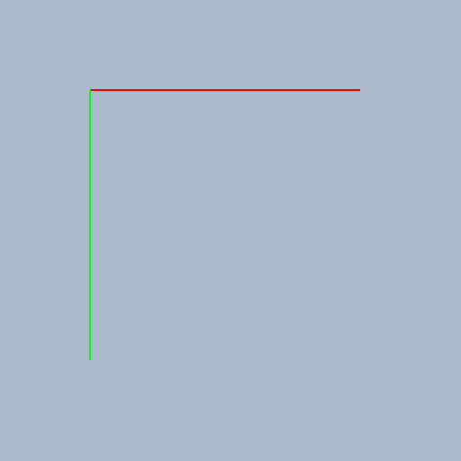
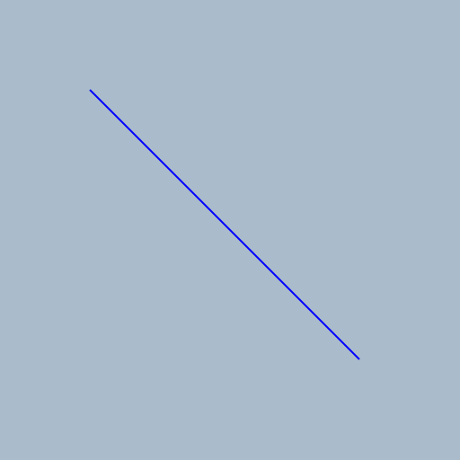
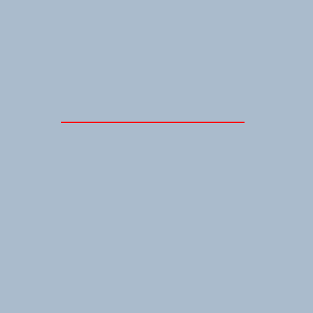
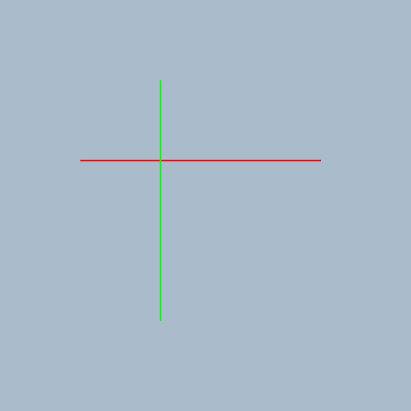

# Start a new drawing project with an initial sketch at the drawing station.

Started 2026-11-07 · finished · 4 drawings

> Two drawings and one revision have been completed

## 1. 2026-11-07

Starting a new drawing project with a simple initial sketch.

## 2. 2026-11-07

Adding a diagonal line to the initial sketch to make it more complex.

## 3. 2026-11-07

Drawing a horizontal red line to add complexity to the initial sketch.

## 4. 2026-11-07

Drawing a horizontal red line and a vertical green line to add complexity to the initial sketch.

[Back to the studio](../README.md)
